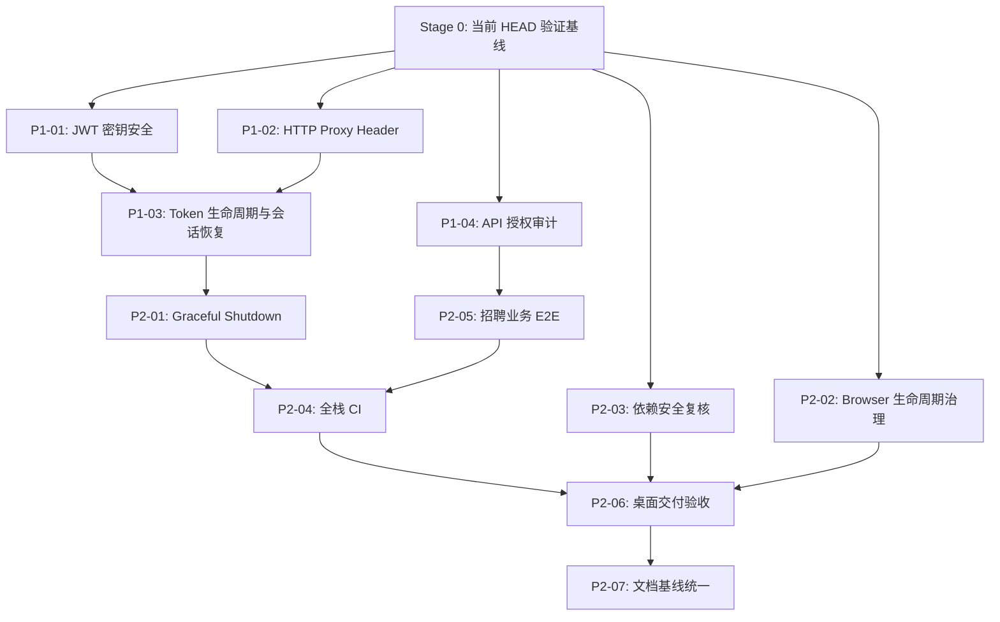

# RICA 全量工程实现审计报告 R1.0

**文档编号：** RICA-AUDIT-001  
**版本：** R1.0  
**审计日期：** 2026-11-22  
**审计对象：** `BryanTianjx/rica`  
**审计分支：** `main`  
**审计方式：** 远程源码静态审查、架构审查、文档审查、测试证据审查  
**审计性质：** 非运行时验收报告  
**状态：** 审计基线已建立，整改待执行

---

# 1. 审计结论

## 1.1 总体评价

RICA 已经从原有 ICA 项目的 Rust 后端迁移，发展为具备领域建模、业务 API、SQLite 持久化、AI 能力、Tauri 桌面集成和 React 前端的完整应用工程。

现有 Rust 分层架构总体合理，Domain、Application、Contracts、Infrastructure、API、Desktop、Server 的职责边界基本清晰。现阶段没有充分证据表明需要推翻整体架构或进行大规模重构。

主要问题集中在：

1. JWT 密钥生成与会话生命周期安全性。
2. Tauri HTTP Proxy 请求头转发不完整。
3. 多用户认证与业务资源授权边界尚未得到证明。
4. 桌面后端进程关闭缺少完整的优雅停机流程。
5. Browser 子系统测试存在超时与进程回收风险。
6. 自动化质量门禁、端到端测试和桌面交付验收不完整。
7. README、测试报告、模块清单等文档与当前代码状态不一致。

**审计结论：** RICA 已具备较完整的应用工程基础，但当前证据不足以将其认定为安全性、可维护性和交付质量均已达标的正式桌面产品。

## 1.2 静态审计评分

| 审计维度 | 评分 | 评价 |
|---|---:|---|
| Rust 分层架构 | 8.5/10 | 职责边界较合理 |
| 领域建模 | 7.0/10 | 核心招聘业务模型已建立 |
| API 设计 | 8.0/10 | 契约基础较完整 |
| 数据持久化 | 7.5/10 | SQLite、Migration、Backup 已具备 |
| 前端工程 | 7.0/10 | 页面和 Backend 抽象已建立 |
| Tauri 集成 | 6.0/10 | 混合 IPC/HTTP 架构仍需完善 |
| 测试体系 | 6.0/10 | 有分层测试，但交付级验证不足 |
| 安全性 | 5.0/10 | 存在需要优先处理的安全问题 |
| 产品交付 | 4.5/10 | 安装、升级、恢复、自动化验收证据不足 |
| **总体** | **6.5/10** | **工程基础较完整，产品化仍需整改** |

评分是本轮静态审查判断，不是自动化测试结果，也不是安全认证结论。

---

# 2. 审计范围与边界

## 2.1 审计范围

| 范围 | 审计内容 |
|---|---|
| Rust Workspace | Cargo Workspace、Crate 依赖、模块职责 |
| Domain | 实体、值对象、领域状态与业务规则 |
| Application | Use Case、Repository Port、业务编排 |
| Contracts | DTO、请求响应结构、共享契约 |
| Infrastructure | SQLite、Migration、AI、OCR、Backup、Secrets |
| API | Axum Router、Endpoint、认证与业务接口 |
| Desktop | Tauri Host、IPC、HTTP Proxy、后端进程管理 |
| Frontend | React 页面、状态管理、Backend Client |
| Testing | Unit、Integration、HTTP、IPC、Contract、E2E |
| Security | JWT、密钥、认证、授权、依赖风险 |
| Documentation | README、ADR、测试报告、缺陷台账 |

## 2.2 审计限制

本轮未执行以下操作：

- 未在本地克隆环境执行 `cargo test`。
- 未执行 `cargo clippy`、`cargo fmt --check`。
- 未执行前端 `npm test`、`npm run build`。
- 未执行 Tauri Windows 构建。
- 未安装和运行 Windows 安装包。
- 未进行真实多用户越权测试。
- 未进行动态渗透测试或依赖漏洞复核。

因此，本报告中：

- **已确认：** 可以从源码或文档直接观察到的实现事实。
- **风险推断：** 多个模块组合后推导出的潜在问题，需要动态测试确认。
- **待核实：** 现有文档或依赖记录提示的问题，尚未完成独立验证。

---

# 3. 缺陷等级定义

| 等级 | 定义 | 处理要求 |
|---|---|---|
| P0 | 已确认的严重安全漏洞、数据破坏或核心功能不可用，且影响范围重大 | 立即处置，暂停相关发布 |
| P1 | 重要安全、认证、核心功能一致性问题 | 当前整改周期优先处理 |
| P2 | 稳定性、测试、质量门禁、工程文档和交付风险 | 纳入近期工程迭代 |
| P3 | 非阻断性优化、体验改善、技术债治理 | 按迭代计划安排 |

本轮静态审计**未确认 P0 缺陷**。这不等于不存在 P0 风险，而是目前没有足够证据将任何发现定级为 P0。

---

# 4. 缺陷总表

| ID | 缺陷标题 | 等级 | 类别 | 处理优先级 |
|---|---|---|---|---|
| SEC-01 | JWT Secret 使用可预测数据生成 | P1 | 安全 | 最高 |
| SEC-02 | Tauri HTTP Proxy 丢失请求头 | P1 | 安全/功能 | 最高 |
| SEC-03 | 桌面重启后 JWT 会话恢复存在风险 | P1 | 认证 | 最高 |
| SEC-04 | 多用户业务 API 授权边界未证明 | P1 | 安全/架构 | 最高 |
| REL-01 | Rust Server 使用强制 Kill 关闭 | P2 | 稳定性 | 高 |
| TEST-01 | Browser POC 缺少完整超时与进程回收保障 | P2 | 测试/稳定性 | 高 |
| SEC-05 | SQLite 及其他依赖安全记录需要复核 | P2 | 供应链安全 | 高 |
| QA-01 | 缺少统一的全栈自动化质量门禁 | P2 | 工程质量 | 高 |
| QA-02 | 招聘核心业务 E2E 证据不足 | P2 | 测试 | 高 |
| QA-03 | Tauri 桌面安装、升级与恢复验收不足 | P2 | 交付 | 高 |
| DOC-01 | README 与当前实现状态不一致 | P2 | 文档 | 中 |
| DOC-02 | 测试报告存在统计和基线矛盾 | P2 | 文档/测试 | 高 |
| DOC-03 | 模块清单与当前代码实现不一致 | P2 | 文档 | 中 |
| DOC-04 | 缺陷台账和项目状态文件未同步 | P2 | 工程管理 | 中 |
| GOV-01 | GitHub 主分支缺少保护和自动化检查 | P2 | 工程治理 | 中 |

---

# 5. 详细缺陷清单

## 5.1 SEC-01：JWT Secret 使用可预测数据生成

**风险等级：P1**

### 问题位置

`desktop/tauri-host/src/main.rs`

涉及函数：

`generate_jwt_secret()`

### 当前实现问题

当前实现通过系统时间纳秒值与进程 PID 进行组合生成 JWT Secret。

该生成方式不属于密码学安全随机数生成机制。时间戳和 PID 存在可预测性，不能作为可靠的 JWT 签名密钥来源。

### 风险影响

- JWT 签名密钥可能被推测。
- 攻击者在满足其他攻击条件时，可能伪造认证 Token。
- 本地桌面应用的认证边界可能被削弱。
- 如果未来扩展远程访问或多用户模式，影响可能进一步扩大。

### 整改建议

1. 使用操作系统提供的 CSPRNG。
2. 使用至少 256 bit 的随机密钥。
3. 明确 JWT Secret 的生命周期。
4. 区分临时密钥与持久化密钥。
5. 如果采用持久化密钥，必须通过系统安全存储保护。
6. 密钥轮换时定义旧 Token 失效策略。
7. 禁止将密钥写入普通日志或诊断信息。

建议采用 Rust `rand` 生态中的 `OsRng` 或其他经过审查的操作系统随机源。

### 验收标准

- [ ] 不再使用时间戳、PID 或普通伪随机数生成 JWT Secret。
- [ ] Secret 至少 32 字节。
- [ ] 密钥生命周期有明确设计。
- [ ] 持久化密钥具备访问控制和安全存储措施。
- [ ] 单元测试验证密钥长度和生成行为。
- [ ] 测试确认不同独立生成过程不会直接复用固定密钥。
- [ ] 日志和错误输出不泄露 Secret。
- [ ] 安全审查通过。

---

## 5.2 SEC-02：Tauri HTTP Proxy 丢失请求头

**风险等级：P1**

### 问题位置

`desktop/tauri-host/src/main.rs`

涉及函数：

- `forward_to(...)`
- HTTP Proxy 请求转发处理逻辑

### 当前实现问题

当前 `forward_to(port, method, path, body)` 没有接收完整的请求头集合。

Proxy 在转发请求时重新构造了部分请求头，但没有完整保留业务所需的 Header。

重点包括：

- `Authorization`
- `X-Encrypt-Aes-Key`
- 其他业务自定义 Header

前端 API Client 会发送 Bearer Token，因此 Proxy 丢失 Authorization 可能造成桌面 HTTP 请求与直接访问 Server 的行为不一致。

### 风险影响

- 认证请求在桌面 Proxy 链路中可能失败。
- 加密导出等功能可能无法获得必要的请求头。
- 不同 Backend 访问方式出现行为差异。
- 后续增加业务 Header 时容易再次发生遗漏。

### 整改建议

1. Proxy 请求转发层增加显式 Header 参数。
2. 建立允许转发的 Header Allowlist。
3. 保留必要的认证和业务 Header。
4. 正确处理 Content-Type、Content-Length。
5. 禁止盲目转发 `Host`、`Connection` 等 hop-by-hop Header。
6. 对响应头建立对应的保留规则。
7. 统一 HTTP Backend 与 IPC Backend 的认证行为。

### 验收标准

- [ ] Authorization 能从前端正确到达 Rust Server。
- [ ] 加密导出相关 Header 可以正常转发。
- [ ] 自定义业务 Header 有明确的转发策略。
- [ ] hop-by-hop Header 不会被错误转发。
- [ ] Proxy 与直连 Server 的业务请求结果一致。
- [ ] 增加 HTTP Proxy 集成测试。
- [ ] 覆盖 401、403、400、500 等错误响应。

---

## 5.3 SEC-03：桌面重启后 JWT 会话恢复存在风险

**风险等级：P1**

### 问题位置

主要涉及：

- `desktop/tauri-host/src/main.rs`
- 前端 AuthContext 实现
- 前端 API Client
- `/auth/me`
- `/auth/*` Token 刷新逻辑

### 问题分析

当前静态代码呈现出以下组合：

1. Tauri Host 启动时生成新的 JWT Secret。
2. 前端 Token 保存在 localStorage。
3. AuthContext 启动时调用 `/auth/me`。
4. API Client 对 `/auth/*` 路径不自动触发 Token Refresh。

如果 JWT Secret 每次 Host 启动都发生变化，之前签发的 Access Token 就可能无法通过新 Secret 验证。

即使数据库中仍然存在 Refresh Token，前端也可能无法自动恢复原有会话。

这是跨模块静态推断，需通过桌面重启场景验证。

### 风险影响

- 应用重启后用户可能被迫重新登录。
- 前端保存的 Token 与后端认证状态不一致。
- 登录状态恢复体验不稳定。
- Access Token 和 Refresh Token 生命周期管理不清晰。

### 整改建议

1. 明确 Access Token 与 Refresh Token 的生命周期。
2. 明确 JWT Secret 是否跨进程重启持久化。
3. 如果采用持久化 Secret，必须与 SEC-01 的安全存储方案统一。
4. 前端启动时建立明确的认证恢复流程。
5. `/auth/me` 返回 401 时，按认证状态机决定是否尝试 Refresh。
6. Refresh 失败后清理本地会话并要求重新登录。
7. 避免无限刷新循环。

### 验收标准

- [ ] 登录后正常退出应用。
- [ ] 再次启动应用。
- [ ] 在有效 Refresh Token 条件下自动恢复会话。
- [ ] Access Token 过期时能够正确刷新。
- [ ] Refresh Token 过期时要求重新登录。
- [ ] 无效 Token 不会恢复为已登录状态。
- [ ] 刷新失败不会无限循环。
- [ ] 多次重启后会话行为一致。

---

## 5.4 SEC-04：多用户业务 API 授权边界未证明

**风险等级：P1**

### 问题位置

重点审查：

- `crates/ica-api/src/routes.rs`
- `crates/ica-api/src/`
- 各业务 Handler
- Application Use Case
- Repository 查询层
- Auth 相关模块

### 当前实现问题

静态审查没有看到可以证明所有业务 API 都经过统一身份认证与资源授权的完整证据。

需要特别区分：

- Auth API 存在。
- 用户可以登录。
- 业务 API 已经受保护。

这三件事并不等价。

当前产品如果采用单机本地模式，未必需要把所有业务 API 都设计成远程多租户架构；但必须明确本地信任边界与未来多用户模式的边界。

### 风险影响

如果未来启用多用户或远程访问：

- 用户可能访问其他用户的候选人数据。
- 用户可能修改不属于自己的招聘职位或沟通记录。
- 业务 API 可能存在 IDOR（不安全直接对象引用）风险。
- 登录认证与资源授权可能脱节。

### 整改建议

1. 明确 Local Mode 与 Multi-user Mode。
2. 定义用户身份、角色、资源所有权模型。
3. 为需要保护的业务 Handler 建立统一认证机制。
4. 在 Application 层实施资源归属校验。
5. Repository 查询按用户或租户范围约束。
6. 对写操作执行授权检查。
7. 为越权场景建立集成测试。
8. 在多用户安全验收完成前，不宣称已经支持安全的多用户隔离。

### 验收标准

- [ ] 有明确的本地模式和多用户模式安全模型。
- [ ] 业务 API 的认证覆盖范围有完整清单。
- [ ] 需要认证的 Handler 均有认证保护。
- [ ] 用户 A 无法读取用户 B 的私有资源。
- [ ] 用户 A 无法修改用户 B 的私有资源。
- [ ] 对候选人、职位、沟通、跟进和草稿等核心实体完成越权测试。
- [ ] 角色权限与资源归属测试通过。
- [ ] 未授权访问返回正确的 401 或 403。

---

## 5.5 REL-01：Rust Server 使用强制 Kill 关闭

**风险等级：P2**

### 问题位置

`desktop/tauri-host/src/main.rs`

涉及函数：

- `stop_backends()`
- Rust Server 子进程管理逻辑

### 当前实现问题

当前后端关闭流程对 Rust Server 使用 `child.kill()`。

这种方式属于强制终止进程，没有充分利用 Server 本身提供的优雅停机能力。

### 风险影响

- 可能中断正在处理的 HTTP 请求。
- 可能造成未完成的文件写入或任务中断。
- 可能使 Backup、Import 等长时间操作无法正常结束。
- 关闭过程缺少可预测的完成状态。

### 整改建议

采用分阶段关闭流程：

1. 通知后端停止接收新请求。
2. 等待现有请求排空。
3. 等待后台任务结束。
4. 设置合理的 Graceful Shutdown Timeout。
5. 超时后执行强制 Kill。
6. 记录关闭结果和超时原因。

### 验收标准

- [ ] 正常退出时优先执行 Graceful Shutdown。
- [ ] 在途请求能够完成或得到明确取消结果。
- [ ] 后台任务有明确的关闭策略。
- [ ] 超时后能够强制终止。
- [ ] 连续启动和关闭 20 次无残留进程。
- [ ] 异常关闭后数据文件仍可正常打开。

---

## 5.6 TEST-01：Browser POC 缺少完整超时与进程回收保障

**风险等级：P2**

### 问题位置

重点审查：

- Browser 子系统 Rust 模块
- Python Sidecar 启动与通信代码
- Browser Worker
- Browser POC 测试代码

### 当前问题

已有缺陷台账记录：Chromium 被发现但无法正常启动时，相关测试可能持续挂起。

测试报告中有三个 POC 测试被 Skip。

### 风险影响

- 自动化测试可能无法结束。
- Browser Worker 可能残留。
- Python Sidecar 或 Chromium 进程可能泄漏。
- CI 执行时间不可控。
- Browser 子系统故障可能影响桌面应用退出。

### 整改建议

1. 为 Worker 启动设置超时。
2. 为 Browser 连接设置超时。
3. 为单次 Browser 操作设置执行超时。
4. 对超时任务实施取消机制。
5. 确保失败路径能够回收进程。
6. 将依赖真实 Chromium 的测试与普通单元测试分离。
7. 将 Skip 原因、环境依赖和恢复条件写入测试报告。

### 验收标准

- [ ] Chromium 不存在时测试能够在限定时间内失败。
- [ ] Chromium 启动失败时不会无限等待。
- [ ] Browser Worker 超时后被正确回收。
- [ ] Python Sidecar 不会残留。
- [ ] 测试失败能够输出明确诊断信息。
- [ ] Browser POC 测试有明确的 Skip 原因。
- [ ] CI 不会因 Browser POC 永久挂起。

---

## 5.7 SEC-05：SQLite 及其他依赖安全记录需要复核

**风险等级：P2**

### 问题位置

- `Cargo.toml`
- `Cargo.lock`
- 仓库依赖安全审计文档

### 当前问题

仓库审计记录提到：

- `libsqlite3-sys 0.30.1`
- `RUSTSEC-2026-0459`
- `chrono`
- `paste`
- `ttf-parser`

其中包含安全公告或维护状态告警。

目前这些记录尚未在本轮独立复核其公告真实性、影响版本和实际调用路径。

### 整改建议

1. 使用 RustSec Advisory Database 对 Cargo 依赖执行扫描。
2. 确认公告 ID、受影响版本和修复版本。
3. 区分直接依赖与传递依赖。
4. 检查 SQLite 实际编译和链接方式。
5. 评估升级对 Windows、macOS 的兼容影响。
6. 对无法立即升级的依赖形成风险接受记录。
7. 将依赖安全扫描纳入 CI。

### 验收标准

- [ ] 生成当前 HEAD 对应的依赖安全扫描报告。
- [ ] 每个告警都有明确处置结论。
- [ ] 可修复漏洞完成升级。
- [ ] 无法升级的漏洞有风险接受记录。
- [ ] Cargo.lock 已同步。
- [ ] 升级后通过 Cargo 测试。
- [ ] Windows 与 macOS 构建兼容性得到验证。

---

## 5.8 QA-01：缺少统一的全栈自动化质量门禁

**风险等级：P2**

### 问题位置

- `scripts/check.py`
- 仓库根目录
- `.github/workflows/`（当前未发现工作流）

### 当前问题

现有检查脚本主要覆盖：

- Rust 依赖分层检查。
- `cargo fmt`。
- `cargo clippy`。
- `cargo test`。

缺少统一覆盖前端、Tauri、E2E、安装包、安全扫描的完整质量门禁。

### 整改建议

建立统一工程检查流水线：

| 阶段 | 检查项目 |
|---|---|
| Rust | fmt、clippy、test |
| Contracts | API/IPC 契约一致性 |
| Frontend | TypeScript、Lint、Vitest、Build |
| Tauri | Desktop Host 编译 |
| Integration | HTTP、IPC、SQLite 集成测试 |
| E2E | 核心招聘业务流程 |
| Security | Cargo Audit、依赖风险检查 |
| Package | Windows 安装包构建与验证 |

建议将本地脚本和 GitHub Actions 设计成复用同一套检查入口，避免本地通过、CI 失败。

### 验收标准

- [ ] 建立 CI Workflow。
- [ ] Rust 检查通过。
- [ ] 前端检查通过。
- [ ] Tauri Host 编译通过。
- [ ] 核心集成测试通过。
- [ ] 依赖安全扫描有结果。
- [ ] 失败时 CI 能够阻止合并。
- [ ] CI 不执行自动发布或自动 Release。

---

## 5.9 QA-02：招聘核心业务 E2E 证据不足

**风险等级：P2**

### 问题位置

- `frontend/src/pages/`
- `crates/ica-application/`
- `crates/ica-api/`
- `crates/ica-infra/`
- 现有测试目录

### 当前问题

已有多层测试，但缺少充分的招聘核心业务端到端验证证据。

建议以完整业务链路，而不是孤立页面或孤立 API 作为验收单位。

### 建议的核心 E2E 场景

1. 创建招聘职位。
2. 创建或导入候选人。
3. 将候选人与职位关联。
4. 创建沟通记录。
5. 生成 AI 沟通草稿。
6. 人工审核草稿。
7. 复制内容并由用户手动发送。
8. 记录发送结果。
9. 创建跟进任务。
10. 完成跟进并更新状态。
11. 关闭应用后重新启动。
12. 验证数据和业务状态完整性。

### 产品边界

E2E 测试应验证现有人工辅助招聘流程，不应将自动发送、浏览器自动化或其他未纳入当前产品范围的能力作为通过条件。

### 验收标准

- [ ] 核心招聘流程至少有一条完整 E2E。
- [ ] AI 草稿生成和人工审核状态正确。
- [ ] 复制与人工发送记录状态正确。
- [ ] 跟进状态流转正确。
- [ ] 失败和取消场景有覆盖。
- [ ] 应用重启后业务数据保持一致。
- [ ] 测试数据可重复初始化和清理。

---

## 5.10 QA-03：Tauri 桌面安装、升级与恢复验收不足

**风险等级：P2**

### 问题位置

- `desktop/`
- Tauri 配置文件
- `scripts/`
- `docs/testing/`

### 当前问题

当前审计未获得充分证据证明以下交付链路已完成：

- 全新安装。
- 原版本升级。
- 数据迁移。
- 备份与恢复。
- 异常退出后的恢复。
- 卸载后的数据保留策略。

### 整改建议

建立独立的 Desktop Release Acceptance 测试矩阵。

### 验收标准

- [ ] Windows 全新安装成功。
- [ ] 首次启动成功。
- [ ] SQLite 数据库自动初始化。
- [ ] 从上一版本升级成功。
- [ ] 数据 Migration 成功。
- [ ] Backup/Restore Drill 成功。
- [ ] 异常退出后可以重新启动。
- [ ] 卸载行为符合数据保留策略。
- [ ] 安装包版本和构建信息可追溯。

---

## 5.11 DOC-01：README 与当前实现状态不一致

**风险等级：P2**

### 问题位置

`README.md`

### 当前问题

README 仍包含部分旧状态：

- API 45/68 的旧统计。
- W5/W6 未实现的旧说明。
- 认证未实现等旧状态。

这些信息与当前实现及较新的文档、测试记录存在不一致。

### 整改建议

README 应定位为当前项目的入口说明，不应承担历史开发进度记录的职责。

建议包含：

- 项目定位。
- 当前架构。
- 当前功能状态。
- 运行环境。
- 安装和启动方法。
- 测试方法。
- 已知限制。
- 文档导航。

### 验收标准

- [ ] README 的 API 数量与当前 Router 一致。
- [ ] 功能状态以当前代码为准。
- [ ] 不再保留已经过时的开发状态。
- [ ] 安装、启动和测试命令实际验证。
- [ ] README 与版本信息一致。

---

## 5.12 DOC-02：测试报告存在统计和基线矛盾

**风险等级：P2**

### 问题位置

`docs/testing/test-report-r1.0.md`

### 当前问题

本轮观察到以下不一致：

- Passed 数量为 385，但收集数记录为 384。
- 一处记录 365/365，另一处记录 385 Passed。
- 前文记录 W5/W6 未覆盖，后文又报告 286/286。
- 存在历史 248/248、286/286 等不同测试基线。
- 报告标记的历史 HEAD 为 `ff7b9eb + uncommitted B1 POC`，不能直接代表当前 HEAD 的测试结果。

这些矛盾不等于历史测试一定无效，但当前报告不能作为单一、可信的验收基线。

### 整改建议

重新建立当前 HEAD 的测试报告。

必须明确：

- Git Commit SHA。
- 测试执行时间。
- 测试环境。
- 测试命令。
- 收集数。
- Passed。
- Failed。
- Skipped。
- 未覆盖范围。
- 测试报告生成版本。

### 验收标准

- [ ] 报告绑定明确 Git SHA。
- [ ] 测试总数与 Passed/Failed/Skipped 数量一致。
- [ ] 所有测试范围定义清楚。
- [ ] Skip 测试具有原因。
- [ ] 历史报告与当前报告分离。
- [ ] 当前报告由真实测试执行结果生成。

---

## 5.13 DOC-03：模块清单与当前代码实现不一致

**风险等级：P2**

### 问题位置

`docs/audits/mvp-r1.0/module-inventory.md`

### 当前问题

模块清单中有关于 Migration、Backup 不存在或未实现的旧描述，但当前代码中已经存在：

- `crates/ica-infra/src/migrations.rs`
- `crates/ica-infra/src/backup.rs`

### 整改建议

重新扫描 Workspace，建立模块级实现清单。

每个模块应区分：

- 已实现。
- 部分实现。
- 未实现。
- 已废弃。
- 待验证。

### 验收标准

- [ ] 模块清单覆盖全部 Crate。
- [ ] 模块状态与源码一致。
- [ ] 对部分实现说明剩余工作。
- [ ] 对废弃模块说明替代方案。
- [ ] 模块清单有基线 Commit SHA。

---

## 5.14 DOC-04：缺陷台账和项目状态文件未同步

**风险等级：P2**

### 问题位置

- `docs/testing/defect-register.md`
- `ICA-RUST.txt`
- 相关审计和项目状态文件

### 当前问题

缺陷台账汇总表未同步 DEF-007/008 等记录。

项目状态文件仍存在旧 VERIFY 状态。

### 整改建议

建立统一缺陷状态管理规则：

- Open
- In Progress
- Fixed
- Verified
- Deferred
- Accepted Risk

缺陷关闭必须同时提供代码变更证据和测试证据。

### 验收标准

- [ ] 缺陷汇总与详细条目一致。
- [ ] 缺陷编号唯一。
- [ ] 缺陷状态定义统一。
- [ ] Fixed 不等于 Verified。
- [ ] Verified 必须关联测试结果。
- [ ] 项目状态文件与实际基线一致。

---

## 5.15 GOV-01：GitHub 主分支缺少保护和自动化检查

**风险等级：P2**

### 问题位置

GitHub 仓库设置：

- `BryanTianjx/rica`
- `main` 分支
- `.github/workflows/`

### 当前问题

本轮观察到：

- `main` 分支未启用保护。
- 未发现仓库级 GitHub Actions Workflow。
- 最新提交未签名。

单独的未签名提交不等同于代码存在安全问题，但缺少分支保护与自动检查会降低工程变更的可控性。

### 整改建议

1. 启用 Pull Request 合并策略。
2. 配置必要的 CI Status Check。
3. 禁止未经检查直接合并。
4. 评估是否要求签名提交。
5. 保护 Release Tag。
6. 不配置自动 Commit、Push、Merge 或 Release。

### 验收标准

- [ ] main 启用 Branch Protection 或 Repository Ruleset。
- [ ] CI 检查成为合并条件。
- [ ] 未通过检查的变更不能合并。
- [ ] 关键分支变更有审查记录。
- [ ] 发布操作需要人工确认。
- [ ] 不存在未经授权的自动发布流程。

---

# 6. 分级实施任务

## 6.1 P0 任务

**本轮没有确认的 P0 缺陷。**

不应为了排期而人为将 P1 问题升级为 P0。

但在执行过程中，如果 SEC-04 的动态测试发现未经认证即可访问敏感数据、跨用户读取或修改数据等严重问题，应重新评估是否升级为 P0，并暂停相关模式的发布。

## 6.2 P1：安全与认证整改

目标：先解决密钥安全、认证链路和业务资源授权问题。

### P1-01：JWT 密钥安全治理

关联缺陷：SEC-01

任务内容：

- 替换 JWT Secret 生成方式。
- 建立密钥生命周期管理。
- 设计密钥持久化与轮换。
- 检查日志泄露风险。

交付物：

- JWT Secret 设计说明。
- 密钥管理实现。
- 单元测试。
- 安全验证记录。

完成标准：SEC-01 全部验收标准通过。

### P1-02：Tauri HTTP Proxy Header 修复

关联缺陷：SEC-02

任务内容：

- 重构 Proxy Header 传递机制。
- 建立请求头 Allowlist。
- 补齐响应头处理。
- 增加 HTTP Proxy 集成测试。

交付物：

- Proxy Header 转发实现。
- Header 策略文档。
- 集成测试报告。

完成标准：SEC-02 全部验收标准通过。

### P1-03：认证恢复与 Token 生命周期治理

关联缺陷：SEC-03

任务内容：

- 梳理 JWT、Access Token、Refresh Token。
- 定义桌面启动认证状态机。
- 修复重启后的认证恢复。
- 增加 Token 过期与失效测试。

交付物：

- Authentication Lifecycle 设计文档。
- 前后端认证恢复实现。
- 桌面重启场景测试报告。

完成标准：SEC-03 全部验收标准通过。

### P1-04：业务 API 授权审计

关联缺陷：SEC-04

任务内容：

- 建立完整业务 API 清单。
- 标记认证要求。
- 梳理用户与业务资源关系。
- 检查 Handler 和 Use Case 授权。
- 增加 IDOR 和越权测试。
- 明确 Local Mode 与 Multi-user Mode。

交付物：

- API Authentication Matrix。
- Resource Authorization Matrix。
- 越权测试报告。
- 安全边界设计文档。

完成标准：SEC-04 全部验收标准通过。

### P1 验收门禁

P1 阶段必须全部完成后，才能将相关安全问题标记为 Verified。

| 缺陷 | 关闭条件 |
|---|---|
| SEC-01 | CSPRNG、密钥生命周期和安全存储验证通过 |
| SEC-02 | Proxy Header 转发和集成测试通过 |
| SEC-03 | 桌面重启及 Token 生命周期测试通过 |
| SEC-04 | 业务 API 认证、授权、越权测试通过 |

---

## 6.3 P2：稳定性、测试、交付和治理整改

### P2-01：后端优雅停机

关联缺陷：REL-01

任务内容：

- 实现 Graceful Shutdown。
- 等待请求排空。
- 增加关闭超时。
- 增加强制 Kill 兜底。
- 增加进程泄漏测试。

交付物：

- 后端关闭流程实现。
- 进程生命周期测试报告。

### P2-02：Browser Worker 生命周期治理

关联缺陷：TEST-01

任务内容：

- 增加 Worker 启动超时。
- 增加 Chromium 连接超时。
- 增加任务执行超时。
- 完善进程取消和回收。
- 修复挂起测试。

交付物：

- Browser Worker 生命周期管理。
- 超时和进程回收测试。

### P2-03：依赖安全复核

关联缺陷：SEC-05

任务内容：

- 执行 Cargo 依赖安全扫描。
- 核实 RustSec 公告。
- 升级可修复依赖。
- 对无法升级项建立风险接受记录。

交付物：

- Dependency Security Report。
- Cargo.lock 更新。
- 风险接受清单。

### P2-04：统一全栈质量门禁

关联缺陷：QA-01、GOV-01

任务内容：

- 建立 GitHub Actions。
- 统一 Rust 和前端检查入口。
- 加入 Tauri 编译检查。
- 加入依赖安全扫描。
- 配置 main 分支保护。
- 保留人工发布机制。

交付物：

- CI Workflow。
- 本地检查脚本。
- Branch Protection 配置记录。

### P2-05：招聘核心业务 E2E

关联缺陷：QA-02

任务内容：

- 建立端到端测试环境。
- 覆盖职位、候选人、沟通、草稿、跟进。
- 验证人工审核和人工发送边界。
- 增加应用重启数据一致性测试。

交付物：

- E2E 测试用例集。
- 自动化执行报告。

### P2-06：桌面交付验收

关联缺陷：QA-03

任务内容：

- Windows 安装包构建。
- 全新安装测试。
- 升级测试。
- 数据迁移测试。
- Backup/Restore Drill。
- 卸载与数据保留测试。

交付物：

- Desktop Release Acceptance Checklist。
- 安装升级测试报告。

### P2-07：文档基线统一

关联缺陷：DOC-01～DOC-04

任务内容：

- 更新 README。
- 重建当前 HEAD 测试报告。
- 更新模块清单。
- 同步缺陷台账。
- 清理旧项目状态。
- 为报告绑定 Git SHA。

交付物：

- README R1.1。
- Test Report R1.1。
- Module Inventory R1.1。
- Defect Register R1.1。
- Project Status R1.1。

---

# 7. 推荐实施顺序

建议按以下阶段实施，避免多个任务同时修改相同核心模块。

| 阶段 | 任务 | 主要目标 |
|---|---|---|
| Stage 0 | 建立当前 HEAD 动态验证基线 | 先确认现状 |
| Stage 1 | P1-01、P1-02 | 修复密钥和 Proxy |
| Stage 2 | P1-03 | 修复认证恢复 |
| Stage 3 | P1-04 | 明确并验证授权边界 |
| Stage 4 | P2-01、P2-02、P2-03 | 稳定性与依赖治理 |
| Stage 5 | P2-04 | 建立全栈 CI 门禁 |
| Stage 6 | P2-05、P2-06 | 核心业务与桌面交付验收 |
| Stage 7 | P2-07 | 完成文档基线同步 |

注意：Stage 0 应先确认真实代码基线和现有测试状态，但不能因此延迟已确认的高风险安全修复。

---

# 8. 任务依赖关系

---

# 9. 建议的工程任务管理字段

建议在 RICA 项目缺陷台账或 Kanban 中统一使用以下字段：

| 字段 | 说明 |
|---|---|
| Task ID | 任务编号 |
| Finding ID | 对应审计缺陷编号 |
| Title | 任务标题 |
| Priority | P0/P1/P2/P3 |
| Status | Open/In Progress/Fixed/Verified/Deferred |
| Module | 受影响模块 |
| File Path | 相关源码路径 |
| Code Location | 函数、类型或模块位置 |
| Risk | 风险说明 |
| Fix Strategy | 整改方案 |
| Acceptance Criteria | 验收标准 |
| Test Evidence | 测试证据 |
| Commit SHA | 实现版本 |
| Reviewer | 审查人 |
| Notes | 其他说明 |

缺陷关闭规则：

- Open：已登记，未处理。
- In Progress：正在整改。
- Fixed：代码修改已完成，但尚未完成独立验证。
- Verified：代码和验收测试均已通过。
- Deferred：明确延期。
- Accepted Risk：经授权接受风险，并记录理由。

**不得仅凭代码修改完成就将安全缺陷标记为 Verified。**

---

# 10. 最终整改目标

完成本轮整改后，RICA 应达到以下工程状态：

1. JWT Secret 使用安全随机源，密钥生命周期明确。
2. Tauri HTTP Proxy 与业务 API 的 Header 行为一致。
3. 桌面应用重启后认证状态可正确恢复。
4. Local Mode 与 Multi-user Mode 的安全边界明确。
5. 核心业务 API 的认证和资源授权有可验证证据。
6. Rust Server 和 Browser Worker 具备可靠的生命周期管理。
7. Rust、React、Tauri、Integration、E2E 形成统一质量门禁。
8. Windows 桌面安装、升级、备份和恢复经过验证。
9. README、模块清单、测试报告和缺陷台账与当前代码一致。
10. main 分支具有可执行的 CI 合并门禁。

## 结论

RICA 当前不需要推翻已有 Rust Workspace，也不建议立即进行大规模架构重构。

正确的整改方向是：

**先修复安全与认证问题，再完善稳定性和质量门禁，最后完成业务 E2E 与桌面交付验收。**

本报告 R1.0 作为当前审计基线。后续整改应以缺陷编号为追踪单位，以当前 Git SHA 为实现基线，以自动化测试和验收证据作为关闭依据。

本报告不授权任何自动 Commit、Push、Merge 或 Release 操作。所有代码修改和发布行为均应由项目维护者明确确认。