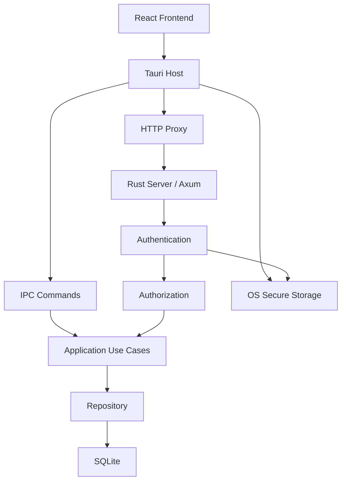
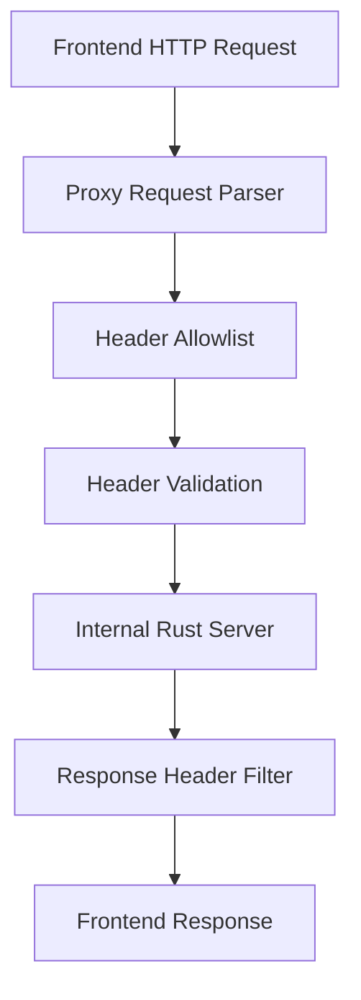
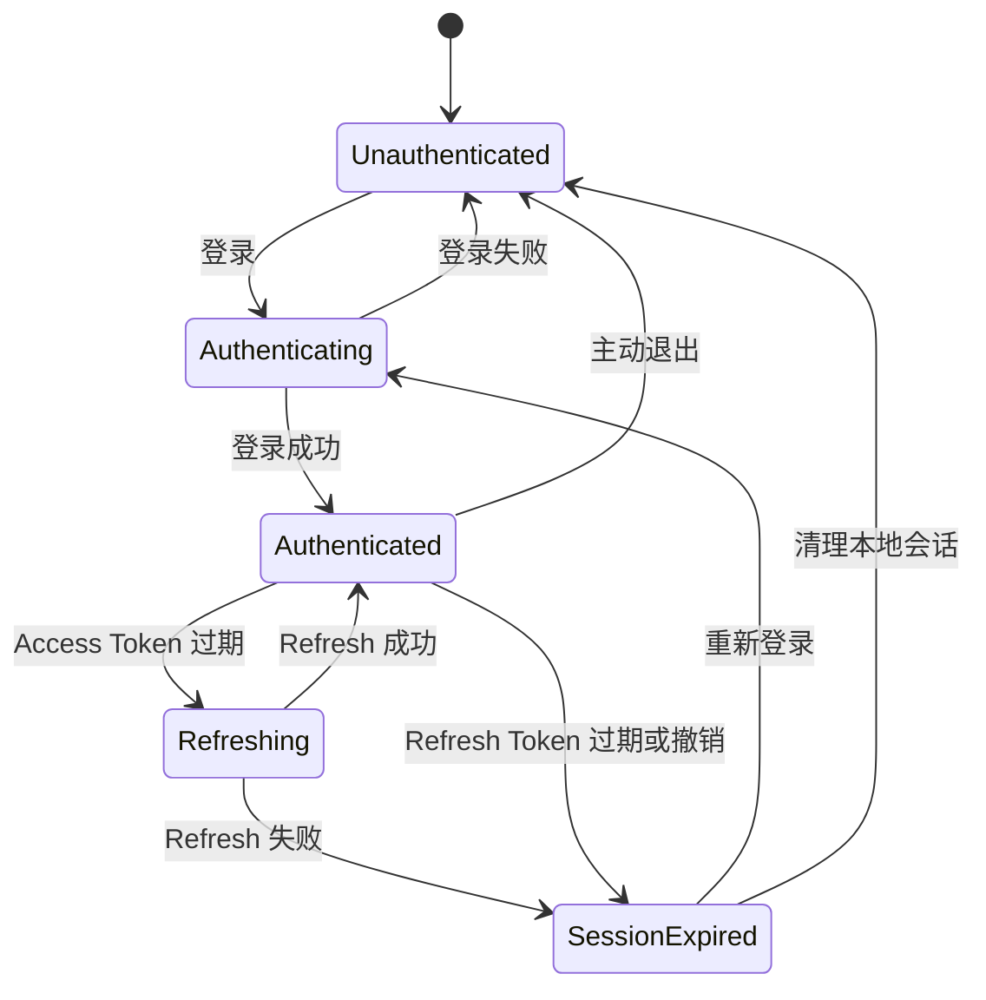

# RICA P1 安全整改实施方案 R1.0

**文档编号：** RICA-SEC-001  
**版本：** R1.0  
**制定日期：** 2026-11-22  
**适用项目：** RICA  
**目标分支：** main（实施时应基于最新确认的代码基线创建工作分支）  
**整改等级：** P1  
**整改范围：** SEC-01、SEC-02、SEC-03、SEC-04  
**文档状态：** 待实施  
**执行方式：** Hermes Agent 多角色协作 + 人工审查

---

# 1. 方案概述

## 1.1 整改目标

解决 RICA 当前静态审计发现的四项关键安全风险：

| 缺陷编号 | 缺陷名称 | 目标 |
|---|---|---|
| SEC-01 | JWT Secret 使用可预测数据生成 | 建立密码学安全的 JWT 密钥管理机制 |
| SEC-02 | Tauri HTTP Proxy 丢失请求头 | 建立安全、完整、可测试的 HTTP 转发机制 |
| SEC-03 | 桌面重启后 JWT 会话恢复存在风险 | 建立可靠的 Token 生命周期与会话恢复机制 |
| SEC-04 | 多用户业务 API 授权边界未证明 | 建立明确的身份认证、资源授权与本地信任边界 |

## 1.2 基本原则

1. 保留现有 Rust Workspace 分层结构。
2. 不引入不必要的新服务和基础设施。
3. 不改变当前招聘业务领域模型。
4. 不将本地单用户模式强行改造成云端多租户架构。
5. 不绕过现有 Authentication、Application 和 Repository 设计。
6. 不在 HTTP Proxy 中无差别转发所有 Header。
7. 不将前端隐藏页面或按钮作为权限控制措施。
8. 不在缺少测试证据时关闭安全缺陷。
9. 所有密钥不得进入普通日志、源码或明文配置文件。
10. 所有修改必须能够独立验证和回滚。

## 1.3 整改完成定义

四项缺陷全部满足以下条件后，P1 安全整改才可以关闭：

- 代码实现完成。
- 单元测试通过。
- 集成测试通过。
- 安全测试通过。
- 关键场景回归通过。
- 安全审查人员确认。
- 缺陷台账更新为 Verified。

---

# 2. 当前架构与安全边界

## 2.1 现有架构

RICA 当前采用 Rust Core + Tauri Desktop + React Frontend 的混合架构。

主要组成：

| 层级 | 组件 | 职责 |
|---|---|---|
| UI | React Frontend | 页面、交互、认证状态 |
| Desktop | Tauri Host | 桌面生命周期、IPC、HTTP Proxy |
| API | Axum | HTTP 路由、请求处理 |
| Application | Use Cases | 业务编排与权限校验 |
| Domain | Domain Models | 业务实体和规则 |
| Infrastructure | SQLx/SQLite | 数据存储、密钥、外部能力 |
| Server | Rust Server | 服务组合与运行 |

## 2.2 安全边界



说明：

- JWT 签发与验证属于 Authentication。
- 资源访问范围属于 Authorization。
- HTTP Proxy 负责安全转发，不承担业务授权。
- IPC 命令必须执行与 HTTP 等价的业务授权规则。
- SQLite 不应被视为天然的用户隔离机制。
- OS Secure Storage 用于保护需要跨应用重启保存的敏感密钥或凭据。

## 2.3 两种运行模式

必须明确区分：

### Local Mode

定位：个人本地招聘工作台。

安全要求：

- 本机用户是主要信任主体。
- 本地 API 不应被非预期网络访问。
- Tauri IPC 命令不能绕过业务校验。
- 浏览器前端不能任意访问不受信任的本地服务。
- 本地数据库和密钥应受到操作系统用户权限保护。
- 认证机制应保持内部一致，避免形成虚假的安全边界。

### Multi-user Mode

定位：未来扩展的多用户运行模式。

安全要求：

- 所有受保护的业务 API 必须具备身份认证。
- 业务资源必须有明确的用户或租户归属。
- Repository 查询必须限制数据范围。
- Application 层必须校验资源所有权。
- 角色权限和资源权限必须分别处理。
- 未授权请求必须拒绝。

**注意：** Multi-user Mode 不在本轮功能扩展范围内。本轮要求建立安全设计和验证基线，不要求实现完整 SaaS 多租户能力。

---

# 3. SEC-01：JWT Secret 安全治理

## 3.1 问题定义

当前代码位置：

`desktop/tauri-host/src/main.rs`

涉及函数：

`generate_jwt_secret()`

当前使用系统时间与进程 PID 组合生成密钥，不能满足密码学安全随机性要求。

## 3.2 设计目标

建立统一的 JWT 密钥管理组件，满足：

1. 密钥由操作系统 CSPRNG 生成。
2. 密钥长度不少于 256 bit。
3. 明确密钥生命周期。
4. 明确密钥持久化策略。
5. 明确密钥轮换策略。
6. 避免多处重复生成和保存密钥。
7. 密钥不得以明文形式暴露在日志和普通配置中。

## 3.3 推荐设计

建议将 JWT 密钥生成和加载从 Tauri Host 中抽离，交由专门的 Infrastructure 安全组件提供能力。

逻辑接口示意：

```rust
pub trait JwtKeyProvider {
    fn load_or_create(&self) -> Result<JwtKey, KeyError>;
}
```

以上为接口设计示意，实际类型和模块位置需要先核查现有 Auth 模块，避免重复造轮子。

推荐职责划分：

| 组件 | 职责 |
|---|---|
| JwtKeyProvider | 密钥读取、创建与生命周期管理 |
| OsRandomSource | 使用操作系统 CSPRNG |
| SecureStorage | 保护持久化密钥 |
| JwtSigner | JWT 签名 |
| JwtVerifier | JWT 验证 |
| KeyRotationPolicy | 密钥轮换策略 |

## 3.4 密钥生成要求

要求：

- 随机字节数：32 字节或更高。
- 随机源：操作系统 CSPRNG。
- 禁止使用 SystemTime 生成密钥。
- 禁止使用 PID 参与密钥生成。
- 禁止使用固定默认 Secret。
- 禁止在开发和生产环境复用相同 Secret。

Rust 实现示意：

```rust
use rand::rngs::OsRng;
use rand::RngCore;

pub fn generate_jwt_secret() -> [u8; 32] {
    let mut secret = [0u8; 32];
    OsRng.fill_bytes(&mut secret);
    secret
}
```

此代码仅为实现方向，最终必须根据仓库当前 `rand` 版本和现有依赖锁定情况调整。

## 3.5 持久化策略

本地桌面应用优先考虑操作系统安全存储。

建议顺序：

1. Windows Credential Manager / DPAPI 保护的凭据存储。
2. macOS Keychain。
3. Linux Secret Service 等系统凭据服务。
4. 无可用安全存储时，使用受当前系统用户权限保护的文件，并明确降低的安全保证。

不得因为使用了本地文件就宣称密钥已获得硬件级保护。

如果系统安全存储不可用：

- 应返回明确错误或进入经过设计的降级模式。
- 不允许静默退回固定密钥。
- 不允许将 Secret 以普通文本写入项目目录。

## 3.6 Token 签发与密钥轮换

需要核查现有 JWT Claims，并确认至少包括：

- `sub`
- `iat`
- `exp`
- `iss`
- `aud`
- `jti`

是否使用应以现有认证协议和产品场景为准。

密钥轮换策略应定义：

- 当前签名密钥。
- 历史验证密钥。
- Token 最大有效期。
- 旧密钥停止验证的时间点。
- 强制失效机制。

若使用 Key ID（`kid`），必须确保验证端仅接受受信任的密钥标识，不允许 Token 自行指定外部密钥地址。

## 3.7 测试要求

| 测试编号 | 场景 | 预期结果 |
|---|---|---|
| SEC01-T01 | 生成 JWT Secret | 长度不少于 32 字节 |
| SEC01-T02 | 连续生成密钥 | 不复用固定值 |
| SEC01-T03 | 时间和 PID 相同条件 | 仍使用 CSPRNG |
| SEC01-T04 | 应用重启 | 持久化策略符合设计 |
| SEC01-T05 | 密钥存储不可用 | 明确失败或安全降级 |
| SEC01-T06 | 日志扫描 | 不包含密钥 |
| SEC01-T07 | 旧密钥轮换 | 按策略验证旧 Token |
| SEC01-T08 | 无效密钥 | Token 验证失败 |

## 3.8 验收条件

SEC-01 只有在密钥生成、持久化、重启、轮换和日志泄露测试全部通过后才能关闭。

---

# 4. SEC-02：Tauri HTTP Proxy Header 安全治理

## 4.1 问题定义

当前代码位置：

`desktop/tauri-host/src/main.rs`

涉及函数：

`forward_to(port, method, path, body)`

当前转发接口未接收完整 Header，导致业务请求头可能丢失。

重点关注：

- Authorization
- X-Encrypt-Aes-Key
- Content-Type
- Content-Length
- 其他经审查允许的业务 Header

## 4.2 设计目标

建立显式、安全的 Header 转发策略。

要求：

1. 必要的业务 Header 不丢失。
2. 不盲目转发浏览器所有 Header。
3. 禁止转发 hop-by-hop Header。
4. 避免 Header 注入。
5. 对敏感 Header 实施白名单控制。
6. 请求和响应均有明确转发策略。
7. Proxy 与直接 HTTP Backend 行为一致。

## 4.3 推荐架构



## 4.4 Header 分类

### 允许转发

按具体业务需要配置：

- Authorization
- Content-Type
- Accept
- X-Request-ID
- X-Encrypt-Aes-Key
- 必要的业务自定义 Header

### 禁止直接转发

至少应排除：

- Connection
- Keep-Alive
- Proxy-Authenticate
- Proxy-Authorization
- TE
- Trailer
- Transfer-Encoding
- Upgrade
- Host

对 `Connection` Header 中声明的其他 hop-by-hop Header 也应正确处理。

Content-Length 应由最终发送的请求体计算或由 HTTP 客户端正确管理，不能信任不一致的用户输入。

## 4.5 安全要求

1. 仅允许 Proxy 访问预期的本机 Server 地址。
2. 禁止由用户输入任意目标 URL 或端口。
3. 限制 Header 总大小。
4. 限制请求体大小。
5. 验证路径和方法。
6. 防止 CRLF Header 注入。
7. 避免将敏感 Header 写入日志。
8. 对跨域请求策略进行明确配置。

特别需要审查 Proxy 是否可能被利用为本地任意端口访问代理。

## 4.6 请求与响应行为

请求方向：

Frontend → Tauri Host → Rust Server

响应方向：

Rust Server → Tauri Host → Frontend

应分别建立 Header Allowlist。

不能因为请求端允许某个 Header，就默认响应端也允许同名 Header。

## 4.7 测试要求

| 测试编号 | 场景 | 预期结果 |
|---|---|---|
| SEC02-T01 | Authorization 转发 | Bearer Token 正确到达 Server |
| SEC02-T02 | 加密业务 Header | 正确传递 |
| SEC02-T03 | 自定义 Header | 按白名单处理 |
| SEC02-T04 | hop-by-hop Header | 不被错误转发 |
| SEC02-T05 | 非法 Header | 拒绝或安全过滤 |
| SEC02-T06 | 超大 Header | 返回明确错误 |
| SEC02-T07 | 超大 Body | 按限制拒绝 |
| SEC02-T08 | 任意端口访问 | 不允许 |
| SEC02-T09 | 401 响应 | 正确返回前端 |
| SEC02-T10 | 500 响应 | 正确返回前端 |
| SEC02-T11 | 加密导出 | 与直接 HTTP Backend 行为一致 |
| SEC02-T12 | 日志检查 | 不泄露 Token 和密钥 |

## 4.8 验收条件

SEC-02 需要同时通过 Header 转发测试、异常响应测试和本地代理边界测试。

---

# 5. SEC-03：JWT 生命周期与桌面会话恢复

## 5.1 问题定义

重点位置：

- `desktop/tauri-host/src/main.rs`
- 前端 AuthContext
- 前端 API Client
- `/auth/me`
- `/auth/*`
- Refresh Token 相关 API 与 Repository

当前静态审查推断：

Tauri Host 重启后可能生成新的 JWT Secret，而前端 localStorage 仍保存旧 Access Token，导致 `/auth/me` 验证失败。

现有 API Client 对认证接口的自动刷新行为也需要进一步核查。

## 5.2 设计目标

建立明确的认证状态机：

- Unauthenticated
- Authenticating
- Authenticated
- Refreshing
- SessionExpired
- AuthenticationError

避免认证恢复依赖多个前端组件各自实现。

## 5.3 推荐认证流程



## 5.4 启动恢复流程

推荐：

1. Tauri Host 启动。
2. 初始化安全密钥。
3. 启动 Rust Server。
4. 等待健康检查通过。
5. 前端读取会话状态。
6. 如果存在可用 Refresh Token，尝试恢复。
7. 获得新的 Access Token。
8. 调用 `/auth/me` 验证当前身份。
9. 恢复前端 Authenticated 状态。
10. 恢复失败时清理无效凭据并要求重新登录。

如果现有设计使用不同的 Refresh 流程，可以保留，但必须保证状态机语义一致。

## 5.5 Token 存储策略

需要区分：

| 数据 | 建议策略 |
|---|---|
| Access Token | 尽量缩短生命周期，避免长期持久化 |
| Refresh Token | 使用安全存储或受保护的服务端会话机制 |
| JWT Signing Secret | 服务端密钥管理，不属于普通前端状态 |
| User Profile | 可以保存非敏感展示信息，但必须重新验证 |

不要将 Refresh Token 当作普通 UI 偏好设置保存。

如果现有认证设计必须使用 localStorage，需要先评估 XSS 风险，并在设计文档中记录接受的风险和保护措施。

对于桌面应用，可以评估 Tauri 原生安全存储能力，将敏感凭据移出 WebView 可直接读取的持久化存储。

## 5.6 Refresh 并发控制

必须防止多个并发请求同时触发 Refresh。

建议采用单飞机制：

- 第一个请求触发 Refresh。
- 其他请求等待同一个 Refresh Promise。
- 成功后统一更新 Access Token。
- 失败后统一清理会话。
- 防止 Refresh 请求再次触发 Refresh。

如果采用 Refresh Token Rotation，还需要正确处理旧 Token 重放和并发刷新。

## 5.7 测试要求

| 测试编号 | 场景 | 预期结果 |
|---|---|---|
| SEC03-T01 | 正常登录 | 进入 Authenticated |
| SEC03-T02 | Access Token 未过期 | 正常恢复 |
| SEC03-T03 | Access Token 过期 | 自动 Refresh |
| SEC03-T04 | 应用正常重启 | 会话恢复 |
| SEC03-T05 | Refresh Token 过期 | 要求重新登录 |
| SEC03-T06 | Refresh Token 撤销 | 要求重新登录 |
| SEC03-T07 | Refresh 并发 | 只执行有效的统一刷新流程 |
| SEC03-T08 | Refresh 返回 500 | 不发生无限重试 |
| SEC03-T09 | 主动退出 | 本地凭据清理 |
| SEC03-T10 | 多次连续重启 | 会话状态保持一致 |
| SEC03-T11 | JWT Secret 不一致 | 旧 Access Token 不能被错误接受 |
| SEC03-T12 | 数据库 Refresh 状态异常 | 安全失败 |

## 5.8 验收条件

SEC-03 必须通过完整桌面生命周期测试，而不仅是 API 单元测试。

重点验证：

- 登录。
- 关闭。
- 重启。
- 恢复。
- Token 过期。
- 刷新失败。
- 主动退出。

---

# 6. SEC-04：业务 API 身份认证与资源授权

## 6.1 问题定义

重点位置：

- `crates/ica-api/src/routes.rs`
- `crates/ica-api/src/`
- `crates/ica-application/src/`
- `crates/ica-domain/src/`
- `crates/ica-infra/src/`

需要确认：

- 哪些 API 需要认证。
- 哪些 API 可以匿名访问。
- 哪些 API 需要管理员权限。
- 哪些 API 需要资源所有权校验。
- IPC 与 HTTP 是否执行相同业务授权规则。

## 6.2 核心原则

认证（Authentication）回答：

> 当前请求是谁发起的？

授权（Authorization）回答：

> 当前请求是否有权执行该操作？

资源归属（Resource Ownership）回答：

> 当前资源是否属于当前用户或租户？

三者不能混为一谈。

## 6.3 API 分类

需要在完整 API 清单基础上建立矩阵。

| API 分类 | 认证要求 | 授权要求 |
|---|---|---|
| Health | 按部署模式决定 | 无业务资源访问 |
| Auth | 按接口语义决定 | 登录、刷新、退出等专属规则 |
| User Profile | 需要 | 只能访问自身信息 |
| Candidates | Multi-user 下需要 | 资源所有权 |
| Positions | Multi-user 下需要 | 资源所有权 |
| Conversations | Multi-user 下需要 | 候选人与沟通记录归属 |
| Follow-ups | Multi-user 下需要 | 资源归属 |
| Drafts | Multi-user 下需要 | 资源归属 |
| Import/Export | 需要 | 数据范围与操作权限 |
| Backup/Restore | 管理权限或本地受信任权限 | 数据库级操作授权 |
| AI Settings | 按部署模式决定 | 配置修改权限 |
| Browser | 按部署模式决定 | 本地能力访问边界 |

以上是设计分类，不代表当前所有接口已经实现对应授权。

最终矩阵必须逐一列出真实 Endpoint、Method、Handler 和权限要求。

## 6.4 身份上下文

建议建立统一的身份上下文：

```rust
pub struct AuthContext {
    pub user_id: UserId,
    pub roles: Vec<Role>,
}
```

如果现有项目已有等价结构，应复用，不要重复建立类型。

身份上下文应由可信认证层构造，不能从普通请求参数中直接接受 user_id 作为已认证身份。

## 6.5 Application 层授权

授权不能只放在 Router Middleware。

推荐采用：

1. API 层完成身份认证。
2. 将可信身份传递给 Application。
3. Use Case 检查操作权限。
4. Repository 查询时限制资源范围。
5. 对跨资源关联进行一致性校验。

例如：

```rust
pub async fn get_candidate(
    auth: &AuthContext,
    candidate_id: CandidateId,
) -> Result<Candidate, ApplicationError> {
    // Verify ownership before returning the resource.
    todo!()
}
```

仅为伪代码，最终必须根据现有 Use Case 和 Repository 接口设计。

## 6.6 IPC 与 HTTP 一致性

当前 Tauri Host 已经存在 IPC 与 HTTP 混合架构。

因此必须确保：

- IPC 不能绕过 Application 层授权。
- HTTP 与 IPC 不能有两套不同的资源访问规则。
- IPC 参数不能直接决定当前用户身份。
- 桌面端隐藏按钮不等于后端授权。
- 对本地高权限命令建立独立能力检查。

建议尽量将业务授权集中在 Application Use Case，而不是分别写在 IPC Handler 和 HTTP Handler 中。

## 6.7 本地模式安全边界

对于 Local Mode：

- Rust Server 仅绑定必要的本机地址。
- 不向局域网默认暴露管理接口。
- IPC 命令限制为应用内部可信调用。
- 本地数据目录受到当前系统用户权限保护。
- 对本机其他进程的访问风险进行明确说明。
- 不将 Local Mode 的安全模型错误宣称为强隔离多用户模型。

如果未来开放网络访问，必须重新评估身份认证、CSRF、CORS、Token 泄露和远程攻击面。

## 6.8 越权测试矩阵

| 测试编号 | 场景 | 预期结果 |
|---|---|---|
| SEC04-T01 | 无 Token 访问受保护 API | 401 |
| SEC04-T02 | 无效 Token | 401 |
| SEC04-T03 | 过期 Token | 按刷新策略处理 |
| SEC04-T04 | 用户 A 访问用户 B 候选人 | 403 或不暴露资源的 404 |
| SEC04-T05 | 用户 A 修改用户 B 职位 | 拒绝 |
| SEC04-T06 | 用户 A 访问用户 B 草稿 | 拒绝 |
| SEC04-T07 | 用户 A 访问用户 B 跟进记录 | 拒绝 |
| SEC04-T08 | 用户 A 访问用户 B 沟通记录 | 拒绝 |
| SEC04-T09 | 修改 URL 中资源 ID | 不得越权 |
| SEC04-T10 | 修改 Body 中 owner_id | 不得越权 |
| SEC04-T11 | IPC 越权调用 | 拒绝 |
| SEC04-T12 | 直接调用 API 绕过前端 | 仍然执行授权 |
| SEC04-T13 | 备份和恢复权限检查 | 只允许授权主体 |
| SEC04-T14 | 跨资源关联访问 | 必须校验关联资源归属 |

注意：当前单用户 Local Mode 未必存在两个真实用户。因此 SEC04 的多用户越权测试可以通过专用测试 Fixture 或隔离测试数据库完成，不应为了测试而改变正式产品数据模型。

## 6.9 验收条件

- 完成全量 Endpoint 权限矩阵。
- 所有受保护接口有身份验证。
- 资源归属校验在可信后端执行。
- HTTP 与 IPC 使用相同业务授权规则。
- 多用户测试覆盖核心业务资源。
- Local Mode 的安全边界明确。
- 不再存在仅依靠前端控制的敏感操作权限。

---

# 7. 跨缺陷协同关系

四项 P1 缺陷并非完全独立。

| 关联关系 | 说明 |
|---|---|
| SEC-01 → SEC-03 | 密钥生命周期直接影响 Token 跨重启有效性 |
| SEC-02 → SEC-03 | Proxy 丢失 Authorization 可能破坏认证恢复 |
| SEC-03 → SEC-04 | 认证上下文是资源授权的基础 |
| SEC-02 → SEC-04 | HTTP Proxy 和 IPC 都必须遵守相同授权规则 |
| SEC-01 → SEC-04 | Token 签名与验证必须使用可靠密钥 |

因此建议实施顺序：

1. SEC-01 密钥安全。
2. SEC-02 Proxy Header。
3. SEC-03 会话恢复。
4. SEC-04 授权边界。

SEC-04 的 API 清单和授权设计可以与 SEC-01、SEC-02 并行进行，但实际业务授权代码应在身份上下文设计稳定后实施。

---

# 8. Hermes Agent 多 Agent 实施组织

## 8.1 角色分工

| Agent | 角色 | 负责范围 |
|---|---|---|
| Agent-01 | Security Architect | 总体安全设计、跨模块协调 |
| Agent-02 | Rust Security Engineer | SEC-01 |
| Agent-03 | Desktop Engineer | SEC-02 |
| Agent-04 | Auth Engineer | SEC-03 |
| Agent-05 | API Security Engineer | SEC-04 |
| Agent-06 | QA Security Reviewer | 独立安全验证 |

## 8.2 Agent 权限边界

Security Architect：

- 负责审查方案。
- 负责确定模块边界。
- 负责审查跨模块接口。
- 不自动修改所有模块。

开发 Agent：

- 仅修改分配的任务范围。
- 不修改其他 Agent 的模块。
- 不自行改变产品安全策略。
- 不自动提交或推送。

QA Security Reviewer：

- 只负责审查和测试。
- 不负责替开发 Agent 修改实现。
- 有权将缺少证据的缺陷判定为未通过。

## 8.3 并行策略

可以并行：

- SEC-01 设计与实现。
- SEC-02 Proxy Header 设计与实现。
- SEC-04 API 权限清单梳理。

应串行：

- SEC-01 的密钥管理方案确认后，再完成 SEC-03 会话持久化设计。
- AuthContext 接口稳定后，再实施 SEC-04 的 Application 授权接入。
- 所有开发完成后，由 QA Security Reviewer 统一验收。

---

# 9. 实施阶段与交付物

| 阶段 | 工作内容 | 主要交付物 |
|---|---|---|
| S0 | 代码基线确认 | Baseline Report |
| S1 | 安全设计确认 | Security Design |
| S2 | SEC-01、SEC-02 | 密钥与 Proxy 修复 |
| S3 | SEC-03 | 认证生命周期实现 |
| S4 | SEC-04 | API 权限与资源授权 |
| S5 | 安全回归 | Security Test Report |
| S6 | 缺陷关闭 | Verified Defect Register |

## 9.1 S0：代码基线确认

执行前必须：

- 获取最新仓库 HEAD。
- 检查是否有未提交修改。
- 确认 Cargo Workspace 状态。
- 确认现有认证模块。
- 确认 Tauri Host 的进程与 Proxy 实现。
- 确认现有测试基线。

不得直接假设本报告中记录的历史源码位置没有变化。

## 9.2 S1：安全设计确认

必须形成：

- JWT Key Lifecycle Design。
- HTTP Proxy Header Policy。
- Authentication State Machine。
- API Authentication Matrix。
- Resource Authorization Matrix。

设计未通过审查前，不进入跨模块大规模修改。

## 9.3 S2～S4：开发实施

每个任务必须包含：

- 修改前行为。
- 修改后行为。
- 修改文件清单。
- 新增测试。
- 兼容性影响。
- 回滚方案。

## 9.4 S5：独立安全验证

QA 应从攻击者视角测试：

- Token 伪造。
- Token 重放。
- Header 丢失。
- Header 注入。
- 本地代理任意端口访问。
- 会话恢复异常。
- 跨用户资源访问。
- IPC 越权。

## 9.5 S6：关闭缺陷

只有全部验收标准满足，才允许将对应 Finding 标记为 Verified。

---

# 10. 回滚策略

| 缺陷 | 回滚策略 |
|---|---|
| SEC-01 | 保留安全密钥迁移策略，不允许回退到时间戳/PID 密钥 |
| SEC-02 | 恢复上一个稳定 Proxy 实现前，必须确认认证与加密 Header 不再被错误丢弃 |
| SEC-03 | 保留 Token 兼容和重新登录方案，不能接受无限期使用旧密钥 |
| SEC-04 | 如果授权实现影响正常访问，先修复授权规则，不得简单关闭全部鉴权 |

安全修复不允许通过重新启用已知不安全逻辑来实现功能回退。

数据库 Schema 如需调整，必须独立提供 Migration 和备份恢复方案。

---

# 11. 总体验收清单

## 安全密钥

- [ ] JWT Secret 使用 CSPRNG。
- [ ] 密钥长度不少于 256 bit。
- [ ] 密钥存储安全。
- [ ] 密钥生命周期明确。
- [ ] 密钥轮换经过测试。

## HTTP Proxy

- [ ] Authorization 正确转发。
- [ ] 加密 Header 正确转发。
- [ ] hop-by-hop Header 正确过滤。
- [ ] 任意端口访问被阻止。
- [ ] 超大 Header 和 Body 被限制。
- [ ] 敏感信息不进入日志。

## 会话恢复

- [ ] 正常登录成功。
- [ ] Access Token 自动刷新。
- [ ] 应用重启恢复成功。
- [ ] Refresh Token 过期后重新登录。
- [ ] Refresh 并发得到正确处理。
- [ ] 主动退出后凭据清理。

## API 授权

- [ ] API 权限矩阵完整。
- [ ] 受保护 API 认证有效。
- [ ] 资源归属校验有效。
- [ ] IPC 不绕过授权。
- [ ] 跨用户访问被拒绝。
- [ ] Local Mode 安全边界明确。

---

# 12. 最终交付标准

本轮 P1 安全整改完成后，至少应提交以下文档：

1. `docs/security/jwt-key-lifecycle.md`
2. `docs/security/http-proxy-header-policy.md`
3. `docs/security/authentication-lifecycle.md`
4. `docs/security/api-authorization-matrix.md`
5. `docs/security/resource-authorization-design.md`
6. `docs/security/p1-security-test-report-r1.0.md`
7. `docs/security/p1-security-defect-register.md`

具体路径可在仓库已有文档结构基础上调整，但不得形成多个互相矛盾的权威版本。

## 最终判定

RICA P1 安全整改的目标不是简单修复四处代码，而是建立四项基础安全能力：

- 安全的密钥管理。
- 可靠的请求转发。
- 可恢复的认证生命周期。
- 可验证的业务资源授权。

只有这四项能力形成完整闭环，RICA 才具备进一步推进桌面产品化和后续多用户能力建设的安全基础。

**本方案不授权自动 Commit、Push、Merge、Release。所有代码变更和发布均需项目维护者明确确认。**